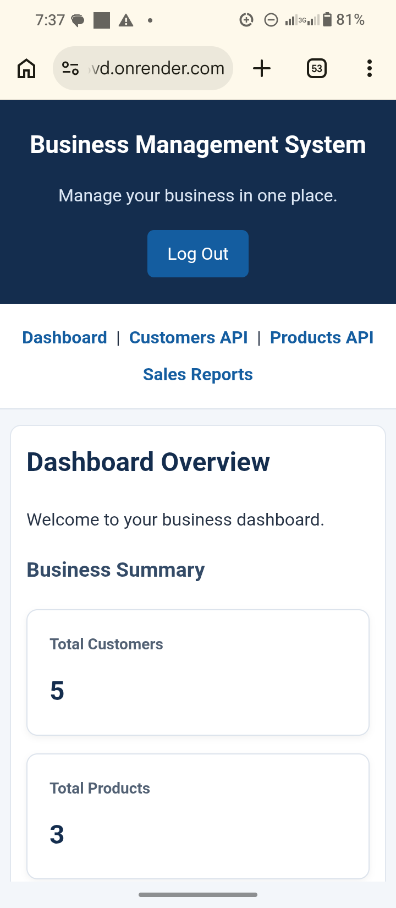
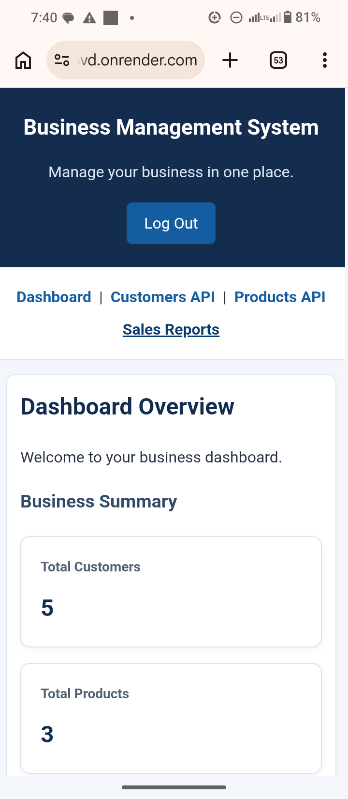
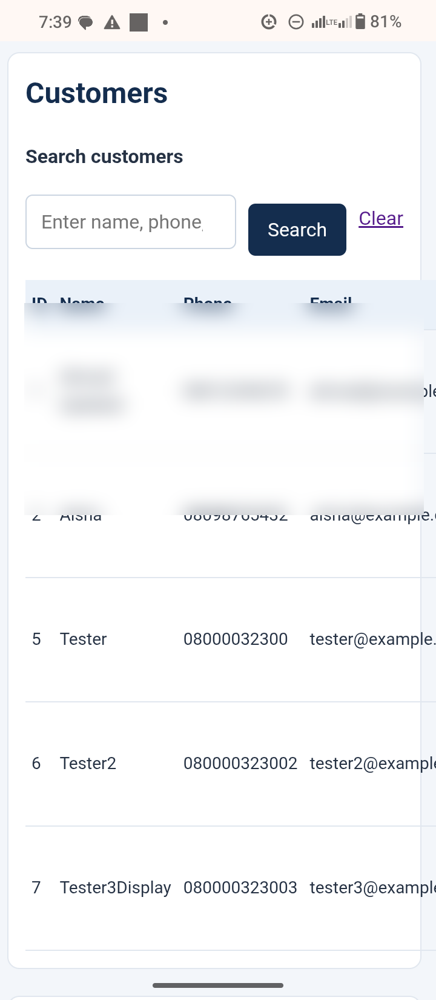
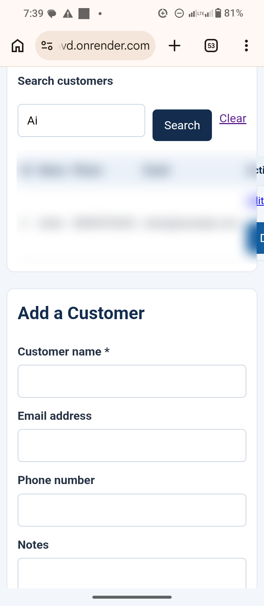
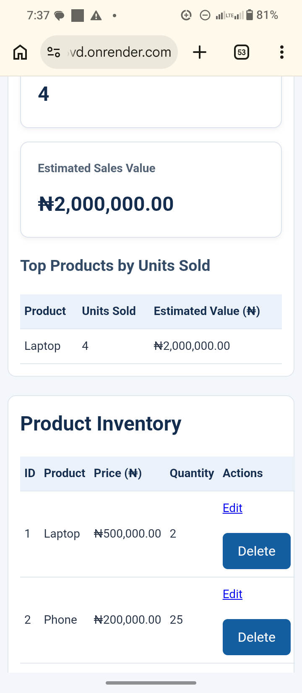
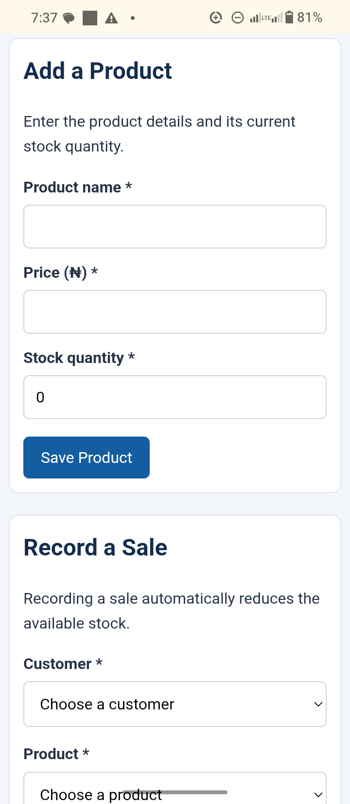
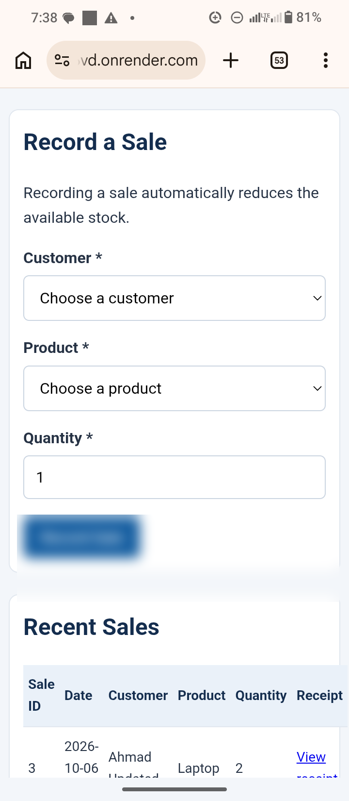
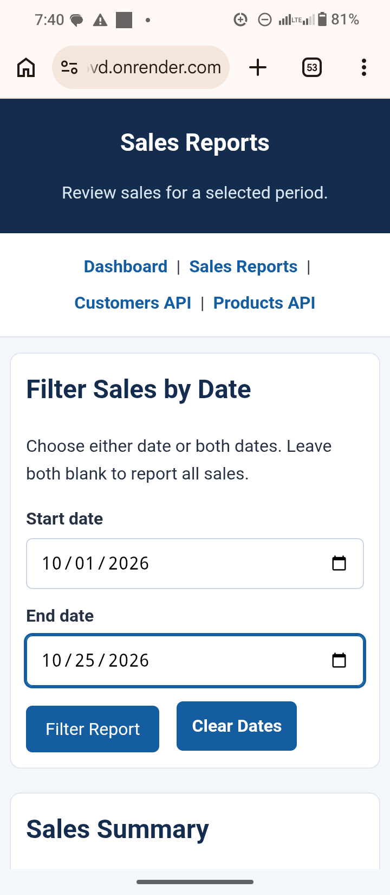
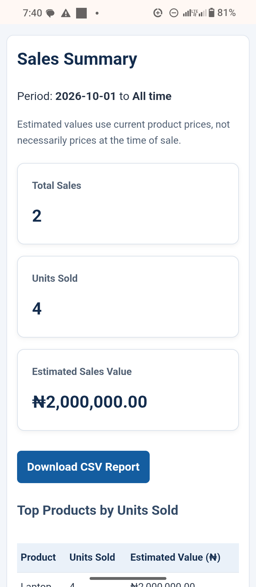
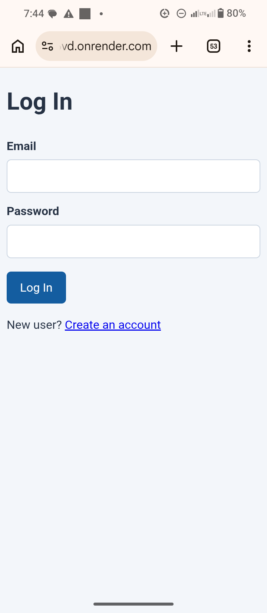

# Business Management System

A web-based business management application built with Python, Flask, and PostgreSQL. It helps users manage customers, products, inventory, sales, and reports through a web dashboard and API endpoints.

## Live Demo

**Application:** https://business-api-r6vd.onrender.com

Protected pages and API endpoints require authentication. No public demo account is provided.

## Features

### Authentication and Security

- User registration and login.
- Password hashing and session-based authentication.
- User-specific data access and ownership checks.
- CSRF protection for applicable web forms.
- JSON authentication and error responses for supported API routes.

### Customer Management

- Create, view, edit, and delete customer records.
- Search customers.
- View sales associated with a customer.

### Product and Inventory Management

- Create, edit, and delete products.
- Manage product prices and stock quantities.
- Track low-stock products.
- Validate product and inventory inputs.

### Sales and Reporting

- Record sales containing individual sale items.
- Update inventory when a sale is recorded.
- Reject invalid quantities and prevent overselling.
- View sales records and receipts.
- Access supported sales reports and reporting endpoints.

## Technology Stack

- **Language:** Python
- **Web framework:** Flask
- **Database:** PostgreSQL
- **ORM:** Flask-SQLAlchemy and SQLAlchemy
- **Database migrations:** Flask-Migrate and Alembic
- **Authentication:** Flask-Login
- **Form security:** Flask-WTF and CSRF protection
- **Configuration:** python-dotenv
- **Production server:** Gunicorn
- **Application hosting:** Render
- **Managed database:** Neon PostgreSQL

## Project Structure

```text
business_api/
|-- app.py
|-- README.md
|-- requirements.txt
|-- Procfile
|-- .gitignore
|-- migrations/
|   |-- alembic.ini
|   |-- env.py
|   |-- README
|   `-- versions/
|-- templates/
|   |-- index.html
|   |-- login.html
|   |-- register.html
|   |-- edit_customer.html
|   |-- edit_product.html
|   `-- reports.html
|-- static/
|   `-- style.css
|-- test_day46.py
|-- test_day48.py
|-- test_day49.py
|-- test_day49_session.py
`-- docs/
    `-- portfolio/
        |-- CASE_STUDY.md
        |-- CLIENT_DEMO_GUIDE.md
        |-- INSTALL_INSTRUCTIONS.md
        |-- PROJECT_SUMMARY.md
        |-- README_GALLERY_SECTION.md
        `-- screenshots/
            |-- 01-dashboard-overview.png
            |-- 02-dashboard-summary.png
            |-- 03-customer-management.png
            |-- 04-customer-search.png
            |-- 05-product-inventory.png
            |-- 06-product-and-sale-forms.png
            |-- 07-sales-recording.png
            |-- 08-sales-report-filters.png
            |-- 09-sales-report-date-range.png
            |-- 10-sales-report-results.png
            `-- 11-login-page.png
```

The application uses Flask routes for web pages and API endpoints, SQLAlchemy for database operations, Jinja templates for the dashboard and forms, and static files for styling.

## Local Development Setup

### Requirements

- Python
- PostgreSQL
- Git

### 1. Clone the repository

```bash
git clone https://github.com/madach-org/business-api.git
cd business-api
```

### 2. Create a virtual environment

On Termux or Linux:

```bash
python -m venv .venv
source .venv/bin/activate
```

On Windows PowerShell:

```powershell
python -m venv .venv
.\.venv\Scripts\Activate.ps1
```

### 3. Install dependencies

```bash
pip install -r requirements.txt
```

### 4. Configure environment variables

Create a local `.env` file containing the configuration required by the application. For example:

```dotenv
FLASK_SECRET_KEY=replace-with-a-long-random-secret
DATABASE_URL=replace-with-your-local-postgresql-connection-string
```

Use your own local database credentials and a securely generated secret. Check `app.py` to confirm the exact environment variable names and database URL format expected by your version of the application.

Never commit `.env` files, passwords, or production credentials to Git.

### 5. Prepare the database

Create and configure a local PostgreSQL database.

Review the migration files and the existing database schema before applying migrations. The migration history depends on the existing database structure. Do not blindly apply migrations to the production database.

### 6. Start the development server

After configuring the environment and database:

```bash
flask --app app run
```

Open this address in your browser:

http://127.0.0.1:5000

## Deployment

The application is configured to use Gunicorn as its production server.

The `Procfile` contains:

```text
web: gunicorn app:app
```

The application is hosted on Render and uses Neon PostgreSQL for its managed database.

Configure the required environment variables in the hosting provider's dashboard. Use a strong production secret, the correct database connection string, and appropriate HTTPS-aware cookie settings in production.

Never publish production credentials in this repository or in screenshots.

## Testing and Validation

Development and acceptance testing covered important application behaviours, including:

- Authentication and protected routes.
- Customer input validation.
- User ownership and access isolation.
- Product and inventory validation.
- Rejection of zero-quantity sales and overselling.
- Sales recording, stock updates, and receipts.

Read-only checks against the deployed application also verified key pages and authentication behaviour. Not every workflow was repeated against production because the live database contains business data.

**Important testing note:** The existing test scripts use the database configured by the application. They do not automatically create or switch to an isolated test database. Before running them, configure a separate test database and verify the test configuration. Do not run tests against the production database or a database containing records you need to preserve.

## Future Improvements

Potential improvements include:

- Automated continuous integration tests.
- API documentation.
- A dedicated demo environment with sample data.
- More monitoring and structured logging.

## License

No open-source license has been specified for this project. All rights are reserved unless a license is added to the repository.

## Screenshots

These portfolio screenshots demonstrate the dashboard, customer management, inventory, sales, and reporting features. Customer table details and a recent-sale row are blurred in the portfolio copies.

### Dashboard





### Customer Management





### Product Inventory





### Sales



### Sales Reports






### Authentication


